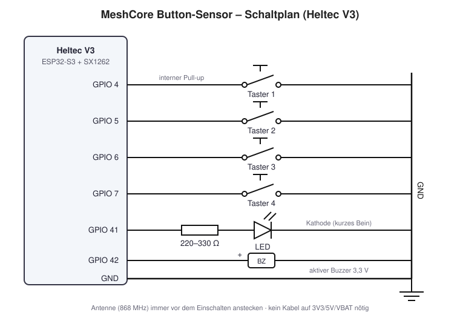

# MeshCore Sensor-Node mit 4 Tastern (Heltec V3)

Stand: 3. November 2026, MeshCore `main` 81dbae5 (Firmware v1.18.0)

## Überblick

Der Aufbau nutzt die offizielle Sensor-Firmware von MeshCore (`examples/simple_sensor`) auf einem Heltec V3. Jeder Tastendruck löst einen Alert aus, der als Direktnachricht an alle Geräte geht, die sich vorher mit dem Admin-Passwort am Sensor angemeldet haben, also etwa ein T-Deck oder ein Handy mit Companion-App.

Eine fertige Firmware zum Flashen gibt es dafür nicht. Sensor-Nodes werden laut MeshCore pro Anwendungsfall selbst gebaut, man passt also `main.cpp` an und kompiliert mit PlatformIO. Der Code hier bringt gleich Entprellen, Cooldown pro Taster und ein Stundenbudget mit.

```
Taster (GPIO) ──> Heltec V3 / simple_sensor ──> Alert als DM ──> eingeloggter Companion (T-Deck, App)
                     │
                     └──> LED + Buzzer als lokale Rückmeldung
```

## Material und Verdrahtung

Die Taster schalten gegen GND und nutzen die internen Pull-ups, Widerstände braucht es dafür nicht. Die gewählten Pins sind auf der Stiftleiste des Heltec V3 herausgeführt und kollidieren nicht mit LoRa, OLED, USB oder den GPS- und I2C-Pins der Sensor-Firmware.

| Bauteil | Heltec-V3-Pin | Anschluss |
| --- | --- | --- |
| Taster 1 | GPIO 4 | andere Seite an GND |
| Taster 2 | GPIO 5 | andere Seite an GND |
| Taster 3 | GPIO 6 | andere Seite an GND |
| Taster 4 | GPIO 7 | andere Seite an GND |
| LED | GPIO 41 | über 220–330 Ω an GND |
| Aktiver Buzzer (3,3 V) | GPIO 42 | Minus an GND |
| LoRa-Antenne (868 MHz) | IPEX-Buchse | immer vor dem Einschalten anstecken |

Dazu ein Breadboard, Steckbrücken und ein USB-C-Kabel. Der Buzzer muss ein aktiver Typ sein, der bei 3,3 V selbst piept. Ein passiver Buzzer oder ein lauter Typ mit mehr als etwa 20 mA gehört hinter einen kleinen NPN-Transistor.

Nicht verwenden: GPIO 0 (Boot-Taster), 8–14 (LoRa), 17/18/21 (OLED), 19/20 (USB), 26/47/48 (GPS), 33/34 (I2C für Umweltsensoren), 35 (Onboard-LED), 36/37 (Vext und Akku-Messung).

## Breadboard bestücken

Am einfachsten geht es auf einem großen Breadboard mit 830 Löchern: oben die Taster und Ausgänge, unten der Heltec, dazwischen die GND-Schiene. Alles ohne Strom aufbauen und den USB-Stecker erst ganz am Ende anstecken.



Der Schaltplan zeigt die elektrischen Verbindungen, die Schritte darunter, wie sie aufs Breadboard kommen. Ob der LED-Widerstand vor oder hinter der LED sitzt, ist egal.

**So ist ein Breadboard aufgebaut:**

- Die langen Schienen am Rand (rot +, blau −) sind der Länge nach verbunden. Bei manchen Boards ist die Schiene in der Mitte unterbrochen, dann beide Hälften mit einer kurzen Brücke verbinden.
- Im Mittelfeld sind immer fünf Löcher einer Querreihe verbunden (a–e bzw. f–j). Der Graben in der Mitte trennt die beiden Hälften.
- Was in derselben Fünfergruppe steckt, ist elektrisch verbunden. Eine Steckbrücke führt vom Bauteil in eine freie Fünfergruppe, in der schon das Kabel zum Heltec steckt.

**Aufteilung:**

```
  blaue Schiene (−)  ══════════════════════ GND für alle Bauteile ═══════

   [T1]    [T2]    [T3]    [T4]      LED+R     Buzzer      <- obere Hälfte
  ───────────────────── Graben ──────────────────────────
   Steckbrücken zu den GPIOs                                <- untere Hälfte

  ┌────────────── Heltec V3 (über den Graben oder am Rand) ──────────────┐
  │ GPIO 4 · 5 · 6 · 7 · 41 · 42 · GND        USB-C            Antenne   │
  └──────────────────────────────────────────────────────────────────────┘
```

**Schritte:**

1. **Heltec einsetzen.** Antenne zuerst anstecken. Dann den Heltec so einsetzen, dass jeder Pin in seiner eigenen Fünfergruppe steckt und daneben noch mindestens ein freies Loch für ein Kabel bleibt. Der Heltec V3 ist breit: Passt er über den Graben nicht so, dass beide Pinreihen noch freie Löcher haben, zwei Breadboards nebeneinander nehmen oder die Pins mit Buchse-Stecker-Kabeln direkt abgreifen. Die GPIO-Nummern stehen neben den Pins auf der Platine, nach diesem Aufdruck gehen, nicht nach der Position.
2. **GND auf die Schiene.** Von einem GND-Pin des Heltec eine Steckbrücke auf die blaue Schiene (−) legen. 3,3 V braucht dieser Aufbau nicht, die Taster nutzen die internen Pull-ups.
3. **Taster setzen.** Jeden Taster über den Graben stecken, mit etwas Abstand zueinander. Ein 4-beiniger Taster hat zwei Beinpaare, die immer verbunden sind. Die sichere Regel: zwei Beine verwenden, die sich diagonal gegenüberliegen. Dann schaltet er in jeder Lage richtig.
4. **Taster verdrahten.** Für jeden Taster ein diagonales Bein mit der blauen Schiene verbinden, das andere mit seinem GPIO: Taster 1 an GPIO 4, Taster 2 an GPIO 5, Taster 3 an GPIO 6, Taster 4 an GPIO 7.
5. **LED setzen.** Das lange Bein (Anode, +) in eine freie Fünfergruppe, das kurze Bein (Kathode, flache Seite am Gehäuse) in eine andere. Von der Anode eine Steckbrücke zu GPIO 41. Den Widerstand (220–330 Ω) von der Kathoden-Gruppe auf die blaue Schiene.
6. **Buzzer setzen.** Plus ist markiert (Aufkleber „+“, längeres Bein). Plus in eine freie Gruppe und mit GPIO 42 verbinden, Minus direkt auf die blaue Schiene.
7. **Kontrolle vor dem Einschalten.**
   - Jeder Taster: ein Bein auf GND, das diagonale auf seinem GPIO
   - Kein Kabel auf 3V3, 5V oder VBAT
   - LED mit Widerstand, nicht direkt zwischen GPIO und GND
   - Keine zwei GPIOs in derselben Fünfergruppe
8. **Einschalten.** USB-C anstecken. Sobald die Firmware drauf ist, reagieren LED und Buzzer bei jedem Tastendruck kurz.

| Von | Nach | Kabelfarbe (Vorschlag) |
| --- | --- | --- |
| Heltec GND | blaue Schiene | schwarz |
| Taster 1, Bein A | GPIO 4 | rot |
| Taster 2, Bein A | GPIO 5 | blau |
| Taster 3, Bein A | GPIO 6 | gelb |
| Taster 4, Bein A | GPIO 7 | weiß |
| Taster 1–4, diagonales Bein B | blaue Schiene | schwarz |
| LED Anode (langes Bein) | GPIO 41 | grün |
| LED Kathode | Widerstand → blaue Schiene | – |
| Buzzer + | GPIO 42 | orange |
| Buzzer − | blaue Schiene | schwarz |

Wenn ein Taster nichts tut: Meistens stecken die zwei verwendeten Beine im selben verbundenen Paar. Dann ist der Taster ständig „gedrückt“ oder nie. Ein Bein um eine Position versetzen, also wirklich diagonal.

## Firmware bauen

Gebaut wird mit VS Code und der PlatformIO-Erweiterung, das Build-Target `Heltec_v3_sensor` ist im MeshCore-Repo schon vorhanden.

1. VS Code und die Erweiterung „PlatformIO IDE“ installieren.
2. MeshCore klonen und auf den getesteten Stand wechseln:

   ```bash
   git clone https://github.com/meshcore-dev/MeshCore.git
   cd MeshCore
   git checkout 81dbae592ffad40b4212bc0b37e82b38da08f4bc   # optional, getesteter Stand
   ```
3. Die Änderungen aus diesem Repo übernehmen, entweder die fertige Datei kopieren:

   ```bash
   cp ../meshcore-button-sensor/firmware/main.cpp examples/simple_sensor/main.cpp
   ```

   oder den Patch anwenden (geht auch auf neueren Ständen, solange sich `main.cpp` nicht stark geändert hat):

   ```bash
   git apply ../meshcore-button-sensor/firmware/simple_sensor-buttons.patch
   ```
4. In `variants/heltec_v3/platformio.ini` beim Abschnitt `[env:Heltec_v3_sensor]` Name und Passwort anpassen:

   ```ini
   -D ADVERT_NAME='"AT-XX-Ort-Sensor"'
   -D ADMIN_PASSWORD='"dein-geheimes-passwort"'
   ```
5. Bauen und per USB flashen:

   ```bash
   pio run -e Heltec_v3_sensor -t upload
   ```

Name und Passwort lassen sich nach dem Flashen auch über die serielle Konsole ändern (`set name …`, `password …`). Das Standard-Passwort `password` sollte in keinem Fall so bleiben.

## Code

Alle Änderungen betreffen nur `examples/simple_sensor/main.cpp`, der Rest der MeshCore-Firmware bleibt unverändert. Die vollständige Datei liegt unter [`firmware/main.cpp`](../firmware/main.cpp).

Pro Taster gilt: entprellen, nur das Drücken melden, höchstens eine Meldung alle 30 Sekunden, insgesamt höchstens 20 pro Stunde. LED und Buzzer geben bei jedem Druck lokal Rückmeldung, auch wenn keine Meldung rausgeht.

**1. Konfiguration** direkt über `class MyMesh`:

```cpp
// ===== Taster, LED, Buzzer =====
static const uint8_t BTN_PINS[4] = { 4, 5, 6, 7 };   // Taster gegen GND
#define LED_PIN        41
#define BUZZER_PIN     42
#define DEBOUNCE_MS    50          // Entprellen
#define COOLDOWN_MS    30000UL     // max. 1 Meldung pro Taster alle 30 s
#define MAX_PER_HOUR   20          // Notbremse: max. 20 Meldungen pro Stunde
#define FEEDBACK_MS    120         // LED/Buzzer-Dauer bei Druck
```

**2. Öffentliche Methoden** in `MyMesh`, direkt nach dem Konstruktor:

```cpp
  void beginInputs() {
    for (int i = 0; i < 4; i++) pinMode(BTN_PINS[i], INPUT_PULLUP);
    pinMode(LED_PIN, OUTPUT);
    pinMode(BUZZER_PIN, OUTPUT);
  }

  void pollInputs() {
    unsigned long now = millis();
    if (feedback_until && now > feedback_until) {   // Rueckmeldung beenden
      digitalWrite(LED_PIN, LOW);
      digitalWrite(BUZZER_PIN, LOW);
      feedback_until = 0;
    }
    for (int i = 0; i < 4; i++) {
      bool pressed = (digitalRead(BTN_PINS[i]) == LOW);
      if (pressed != raw[i]) { raw[i] = pressed; changed_at[i] = now; }
      if (now - changed_at[i] < DEBOUNCE_MS || pressed == stable[i]) continue;
      stable[i] = pressed;
      if (!pressed) continue;                 // nur Druecken melden, Loslassen nicht

      digitalWrite(LED_PIN, HIGH);            // lokale Rueckmeldung, kostet keine Airtime
      digitalWrite(BUZZER_PIN, HIGH);
      feedback_until = now + FEEDBACK_MS;

      if (last_sent[i] && now - last_sent[i] < COOLDOWN_MS) continue;  // Cooldown
      if (!budgetOk(now)) continue;                                     // Stundenbudget
      last_sent[i] = now;

      char text[32];
      snprintf(text, sizeof(text), "Taster %d gedrueckt", i + 1);
      alertIf(false, btn_alert[i], LOW_PRI_ALERT, "");   // alten Alert zuruecksetzen
      alertIf(true,  btn_alert[i], LOW_PRI_ALERT, text); // neuen Alert einreihen
    }
  }
```

**3. Zustand** im `protected`-Bereich, unter `custom logic here`:

```cpp
  Trigger btn_alert[4];
  bool raw[4] = {}, stable[4] = {};
  unsigned long changed_at[4] = {}, last_sent[4] = {};
  unsigned long hour_start = 0, feedback_until = 0;
  uint8_t sent_this_hour = 0;

  bool budgetOk(unsigned long now) {
    if (now - hour_start > 3600000UL) { hour_start = now; sent_this_hour = 0; }
    if (sent_this_hour >= MAX_PER_HOUR) return false;
    sent_this_hour++;
    return true;
  }
```

**4. Aktor-Befehle** in `handleCustomCommand()`, statt des Beispiels `magic`. Damit lassen sich LED und Buzzer aus der App fernsteuern, das ist der Aktor-Teil:

```cpp
    if (strcmp(command, "led on") == 0)  { digitalWrite(LED_PIN, HIGH); strcpy(reply, "LED an");  return true; }
    if (strcmp(command, "led off") == 0) { digitalWrite(LED_PIN, LOW);  strcpy(reply, "LED aus"); return true; }
    if (strcmp(command, "beep") == 0) {
      digitalWrite(BUZZER_PIN, HIGH);
      feedback_until = millis() + 500;   // pollInputs() schaltet wieder ab
      strcpy(reply, "Beep");
      return true;
    }
```

**5. Einhängen** in `setup()` nach `the_mesh.begin(fs);` bzw. in `loop()` nach `the_mesh.loop();`:

```cpp
  the_mesh.beginInputs();   // in setup()
  the_mesh.pollInputs();    // in loop()
```

**6. Akku-Alarme entschärfen.** Das Original-Beispiel meldet „Battery is critical!“ mit Wiederholungen. Am USB ohne Akku kann das ungewollt auslösen, daher vor den beiden `alertIf`-Zeilen in `onSensorDataRead()`:

```cpp
    bool has_batt = batt_voltage > 2.5f;   // ohne Akku (nur USB) keine Akku-Alarme
```

und beide Bedingungen mit `has_batt && …` ergänzen.

**Warum `LOW_PRI_ALERT`:** Ein Alert mit niedriger Priorität wird einmal gesendet, ohne auf ein ACK zu warten. Hohe Priorität wiederholt bis zu vier Mal pro Empfänger, bis ein ACK kommt. Für Taster reicht niedrig.

**Variante Türkontakt:** Wer „OFFEN/ZU“ melden will, lässt die Zeile `if (!pressed) continue;` weg und baut den Text aus dem Zustand, etwa `pressed ? "Kontakt %d ZU" : "Kontakt %d OFFEN"`. Der Cooldown bleibt trotzdem drin.

## Anmelden und testen

Damit Meldungen ankommen, muss sich der Empfänger einmal mit dem Admin-Passwort am Sensor anmelden. Erst dann steht er in der Empfängerliste des Sensors.

1. Heltec per USB versorgen. Im OLED erscheinen Name und Status.
2. Über die serielle Konsole (115200 Baud) `advert` senden, damit der Sensor in der Kontaktliste auftaucht.
3. Im Companion (App oder T-Deck) den Sensor öffnen und mit dem Admin-Passwort anmelden, genauso wie bei einem Repeater.
4. Einen Taster drücken: LED und Buzzer reagieren sofort, die Nachricht „Taster 1 gedrueckt“ kommt als Direktnachricht.
5. Gleich nochmal drücken: Es piept, aber innerhalb von 30 Sekunden geht keine zweite Nachricht raus. Das ist der Cooldown.
6. Über die Admin-Konsole des Sensors in der App `led on`, `led off` oder `beep` senden, um den Aktor-Teil zu testen.

Ohne eigenen Code kann die Standard-Firmware `simple_sensor` bereits Folgendes: Akkuspannung als Telemetrie melden, einen 24-Stunden-Verlauf speichern, bei niedrigem Akku alarmieren und die üblichen Admin-Befehle beantworten. Taster und Ausgänge gehören nicht dazu, die bringt erst dieser Code.

## Spielregeln für das Mesh

Solange Sensor und Empfänger nebeneinander liegen, ist alles Zero-Hop und das Mesh merkt nichts. Sobald der Node über Repeater läuft, gilt:

- **Direktnachricht statt Public-Kanal.** Alerts gehen bei MeshCore ohnehin als DM an die angemeldeten Empfänger. Nichts davon in einen öffentlichen Kanal umbauen.
- **Cooldown und Budget drinlassen.** Jede Nachricht erzeugt ein ACK, und ist kein Pfad bekannt, geht sie per Flood durchs ganze Netz.
- **Nur Änderungen melden.** Ein Druck ist eine Meldung, keine zwei. Messwerte selten und gesammelt schicken.
- **Wenige Empfänger.** Jeder angemeldete Empfänger bekommt jede Meldung einzeln.
- **Ankündigen.** Kurz in der Gruppe sagen, was der Node macht und wo er steht.

## Community-Projekte und Quellen

Ein fertiges Community-Projekt für Taster an einem MeshCore-Sensor-Node war zum Zeitpunkt des Schreibens nicht zu finden. Die nächstgelegenen Anlaufstellen:

- [Sensor Node Intro, MeshCore Blog (14.09.2026)](https://blog.meshcore.io/2026/09/14/sensor-intro): offizielle Einführung in `simple_sensor`, Alerts, Telemetrie und eigene Befehle
- [MeshCore, examples/simple_sensor](https://github.com/meshcore-dev/MeshCore/tree/main/examples/simple_sensor): die Vorlage, auf der diese Anleitung aufbaut
- [Feature Request: GPIO support in MeshCore (#3522)](https://github.com/meshcore-dev/MeshCore/issues/3522): Vorschlag, GPIOs künftig direkt per CLI lesen und schalten zu können, noch offen
- [esphome-meshcore](https://github.com/netmilk/esphome-meshcore): ESPHome-Komponente für Befehl und Antwort über MeshCore, derzeit nur XIAO nRF52840, kein ESP32
- [m3buzzer](https://github.com/achildrenmile/m3buzzer): Firmware-Patch für ThinkNode M3 mit Taster-Nachrichten in einen Kanal
- [MeshCore Flasher](https://flasher.meshcore.io) und [Dokumentation](https://docs.meshcore.io)
