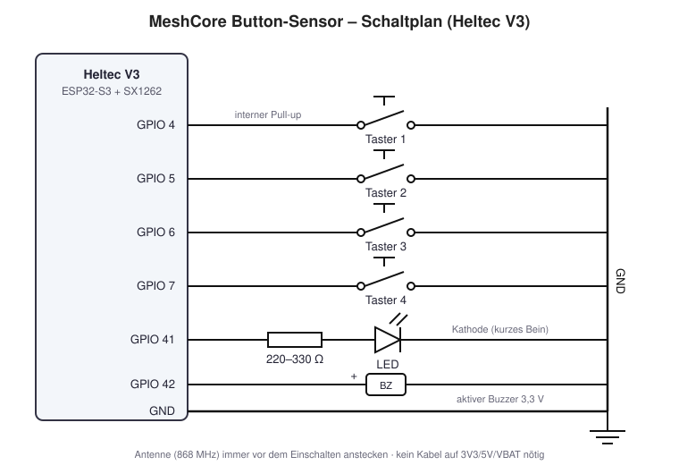

# button-sensor

Vier Taster, eine LED und ein Buzzer an einem Heltec V3. Ein Tastendruck schickt eine Direktnachricht an angemeldete Companions (App oder T-Deck). LED und Buzzer lassen sich aus der App fernsteuern, der Node ist damit Sensor und Aktor zugleich.



| | |
| --- | --- |
| Hardware | Heltec V3, 4 Taster, LED + 220–330 Ω, aktiver Buzzer 3,3 V |
| Build-Target | `Heltec_v3_sensor` |
| Meldet | „Taster N gedrueckt“ als Low-Priority-Alert per DM |
| Steuerbar | `led on`, `led off`, `beep` über die Admin-Konsole |
| Airtime-Schutz | 1 Meldung pro Taster alle 30 s, max. 20 pro Stunde |
| Getestet gegen | MeshCore `main` 81dbae5 (v1.18.0) |
| Status | nicht auf Hardware getestet |

## Dateien

| Datei | Inhalt |
| --- | --- |
| [`anleitung.md`](anleitung.md) | Verdrahtung, Breadboard, Build, Code, Test |
| [`schaltplan.svg`](schaltplan.svg) / [`.png`](schaltplan.png) | Schaltplan |
| [`firmware/main.cpp`](firmware/main.cpp) | fertige `main.cpp` für `examples/simple_sensor` |
| [`firmware/simple_sensor-buttons.patch`](firmware/simple_sensor-buttons.patch) | dieselben Änderungen als Patch für `git apply` |

## Schnellstart

```bash
git clone https://github.com/meshcore-dev/MeshCore.git
git clone https://github.com/achildrenmile/carinthiamesh-sensor-nodes.git
cd MeshCore
cp ../carinthiamesh-sensor-nodes/examples/button-sensor/firmware/main.cpp examples/simple_sensor/main.cpp
# ADVERT_NAME und ADMIN_PASSWORD in variants/heltec_v3/platformio.ini [env:Heltec_v3_sensor] anpassen
pio run -e Heltec_v3_sensor -t upload
```

Danach im Companion mit dem Admin-Passwort am Sensor anmelden und einen Taster drücken. Alles Weitere in der [Anleitung](anleitung.md).

## Verdrahtung

| Bauteil | Heltec-V3-Pin | Anschluss |
| --- | --- | --- |
| Taster 1–4 | GPIO 4, 5, 6, 7 | andere Seite an GND (interne Pull-ups) |
| LED | GPIO 41 | über 220–330 Ω an GND |
| Aktiver Buzzer (3,3 V) | GPIO 42 | Minus an GND |

Allgemeine Hinweise zu Sensor-Nodes und Airtime stehen im [Haupt-README](../../README.md).
