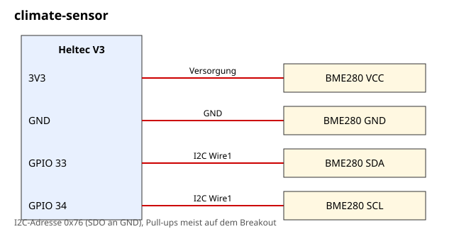

# climate-sensor

Ein BME280 am Heltec V3 misst Temperatur, Luftfeuchte und Luftdruck. Die Werte holt sich ein angemeldeter Companion per Telemetrie-Abfrage. Zusätzlich gibt es Alerts bei Frostgefahr und hoher Luftfeuchte, etwa für Keller, Gartenhaus oder Wochenendhaus.

| | |
| --- | --- |
| Hardware | Heltec V3, BME280-Breakout (I2C) |
| Build-Target | `Heltec_v3_sensor` (BME280 ist dort schon aktiviert, I2C auf GPIO 33/34) |
| Meldet | „Frostgefahr“ (unter 2 °C, zurück über 4 °C), „Luftfeuchte hoch“ (über 70 %, zurück unter 65 %) |
| Abfragbar | Telemetrie: Akku, Temperatur, Luftfeuchte, Luftdruck, Höhe; Min/Max/Mittel der letzten 24 h |
| Airtime-Schutz | Messwerte nur auf Abfrage; Alerts mit Hysterese, nur bei Zustandswechsel |
| Getestet gegen | MeshCore `main` 81dbae5 (v1.18.0), `pio run -e Heltec_v3_sensor` erfolgreich (3. Nov. 2026) |
| Status | kompiliert, nicht auf Hardware getestet |

## Dateien

| Datei | Inhalt |
| --- | --- |
| [`BOM.md`](BOM.md) | Stückliste |
| [`anleitung.md`](anleitung.md) | Verdrahtung, Build, Test |
| [`schaltplan.svg`](schaltplan.svg) | Schaltplan |
| [`firmware/main.cpp`](firmware/main.cpp) | fertige `main.cpp` für `examples/simple_sensor` |

## Verdrahtung

| BME280 | Heltec-V3-Pin |
| --- | --- |
| VCC | 3V3 |
| GND | GND |
| SDA | GPIO 33 |
| SCL | GPIO 34 |

## Anderes Board

Die Pins oben gelten für den Heltec V3. Auf anderem Board:

1. Ein Target mit `examples/simple_sensor` verwenden. Eines gibt es für viele Boards schon, z. B. `RAK_4631_sensor`, sonst im Varianten-`platformio.ini` eines anlegen.
2. Freie GPIOs mit 3,3 V Logik wählen und per Build-Flag setzen: keine Pins in `main.cpp`; der I2C-Bus kommt aus dem Target (`ENV_PIN_SDA`, `ENV_PIN_SCL`) und die Adresse aus `TELEM_BME280_ADDRESS`. Beispiel: `-D ENV_PIN_SDA=13 -D ENV_PIN_SCL=14`
3. Pegel und Versorgung prüfen, die meisten Boards vertragen 3,3 V, nicht 5 V.
4. Den Aufbau mit dem Test aus der [Anleitung](anleitung.md) prüfen.

Kompiliert wurde mit den Heltec-Defaults für `Heltec_v3_sensor` sowie mit überschriebenen Pins für `RAK_4631_sensor` und `Xiao_nrf52_sensor`. Xiao nRF52840: Target aus [`targets/xiao_nrf52_sensor.ini`](../../targets/xiao_nrf52_sensor.ini) anlegen, keine Pins nötig (BME280 an D6 SCL und D7 SDA). Funktioniert hat es auf keinem Board in echt.

Allgemeine Hinweise zu Sensor-Nodes und Airtime stehen im [Haupt-README](../../README.md).
