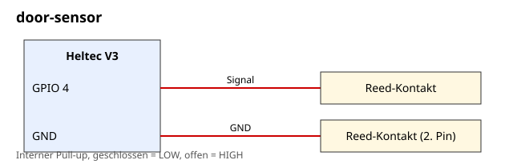

# door-sensor

Ein Reed-Kontakt an einem Heltec V3 meldet, wenn eine Tür, ein Fenster oder ein Schaltschrank geöffnet oder geschlossen wird. Die Meldung kommt als Direktnachricht in die Companion-App.

| | |
| --- | --- |
| Hardware | Heltec V3, Reed-Kontakt mit Magnet |
| Build-Target | `Heltec_v3_sensor` |
| Meldet | „Tuer offen“ / „Tuer geschlossen“ als Low-Priority-Alert per DM |
| Steuerbar | `status` in der Admin-Konsole fragt den Zustand ab |
| Airtime-Schutz | Entprellen 200 ms, 1 Meldung pro Minute, max. 20 pro Stunde |
| Getestet gegen | nicht kompiliert; gebaut auf MeshCore `main` 81dbae5 (v1.18.0) |
| Status | nicht auf Hardware getestet |

## Dateien

| Datei | Inhalt |
| --- | --- |
| [`BOM.md`](BOM.md) | Stückliste |
| [`anleitung.md`](anleitung.md) | Verdrahtung, Build, Test |
| [`schaltplan.svg`](schaltplan.svg) | Schaltplan |
| [`firmware/main.cpp`](firmware/main.cpp) | fertige `main.cpp` für `examples/simple_sensor` |

## Verdrahtung

| Bauteil | Heltec-V3-Pin |
| --- | --- |
| Reed-Kontakt, Pin 1 | GPIO 4 (interner Pull-up) |
| Reed-Kontakt, Pin 2 | GND |

Allgemeine Hinweise zu Sensor-Nodes und Airtime stehen im [Haupt-README](../../README.md).
