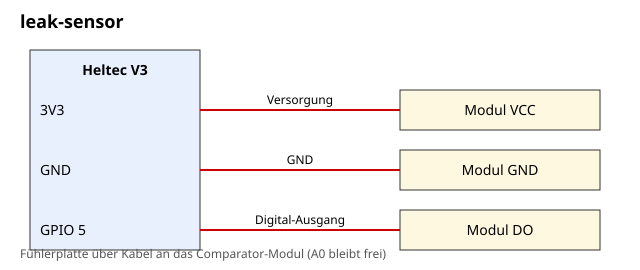

# leak-sensor

Ein Wassermelder für Keller, Waschmaschine oder Heizungsraum. Ein Feuchtesensor-Modul mit Digital-Ausgang liefert den Pegel, der Heltec V3 schickt bei Nässe einen Alert mit hoher Priorität. Der wird wiederholt, bis ein Companion den Empfang bestätigt.

| | |
| --- | --- |
| Hardware | Heltec V3, Wassersensor-Modul mit Comparator (DO-Ausgang) |
| Build-Target | `Heltec_v3_sensor` |
| Meldet | „Wasser erkannt!“ als High-Priority-Alert per DM |
| Steuerbar | `status` in der Admin-Konsole: „nass“ oder „trocken“ |
| Airtime-Schutz | Wasser muss 2 s anliegen, nach einer Meldung 10 min Ruhe, max. 6 pro Stunde |
| Getestet gegen | nicht kompiliert; gebaut auf MeshCore `main` 81dbae5 (v1.18.0) |
| Status | nicht auf Hardware getestet |

## Dateien

| Datei | Inhalt |
| --- | --- |
| [`BOM.md`](BOM.md) | Stückliste |
| [`anleitung.md`](anleitung.md) | Verdrahtung, Build, Test |
| [`schaltplan.svg`](schaltplan.svg) | Schaltplan |
| [`firmware/main.cpp`](firmware/main.cpp) | fertige `main.cpp` für `examples/simple_sensor` |

## Verdrahtung

| Modul | Heltec-V3-Pin |
| --- | --- |
| VCC | 3V3 |
| GND | GND |
| DO | GPIO 5 |

Allgemeine Hinweise zu Sensor-Nodes und Airtime stehen im [Haupt-README](../../README.md).
